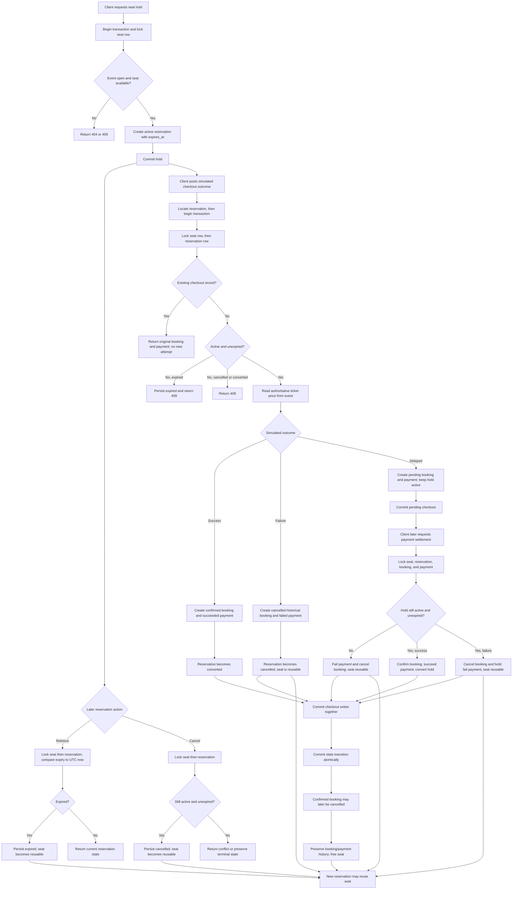

# Reservation and booking workflow

Every mutating reservation/checkout path locks the concrete seat before the
reservation row and uses a database transaction. Settlement also locks the
booking and payment before updating them. A database error rolls back the
booking, payment, and reservation transition together. Delayed payment is
settled by an explicit later API request; no sleeping request or background
payment task is used. Expiry is lazy: no background job currently expires
untouched holds. Cancelling a confirmed booking preserves the succeeded
payment record and does not issue a refund.

Reservation creation, reservation reads/cancellation, checkout, settlement,
and caller booking history require a syntactically valid `X-User-Ref`. For
owned rows, mutations verify the owner after acquiring their existing seat-
first locks; no additional row locks are taken. A non-NULL owner mismatch
returns 403. Legacy rows whose nullable `user_ref` is NULL remain accessible
with any valid reference. This header is caller-controlled identification,
not authentication; comparisons are case-sensitive. Idempotency fingerprints include the caller reference,
so another caller cannot replay a keyed reservation or checkout response.
