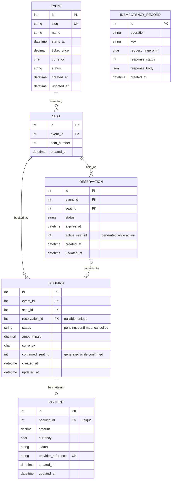

# The Last Seat entity relationship diagram

This diagram reflects the five booking-domain SQLAlchemy models and the
additional durable idempotency model, with their current foreign
keys. `Seat.event_id` plus `Seat.id` is the referenced composite key used to
ensure reservations and bookings use seats from the same event.

The active-reservation and confirmed-booking generated keys have unique
indexes with `event_id`. The nullable generated key lets historical terminal
rows coexist while preventing two active holds or two confirmed bookings for
the same event seat. A unique nullable `Booking.reservation_id` links at most
one booking to a reservation; a unique `Payment.booking_id` allows at most one
payment record for a booking. Pending bookings do not set the confirmed-seat
key; their active reservation protects that seat until settlement, cancellation,
or expiry. `IdempotencyRecord` is independent of those domain foreign keys;
`uq_idempotency_operation_key` uniquely scopes the client key by operation.
Its fingerprint and response are committed in the same transaction as the
associated successful reservation or checkout.
